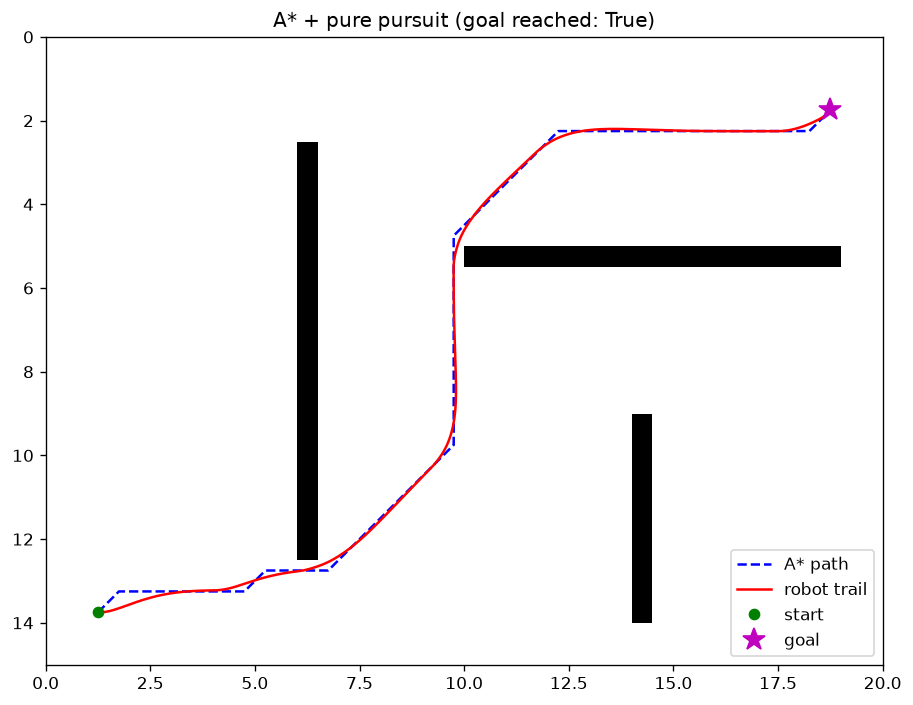
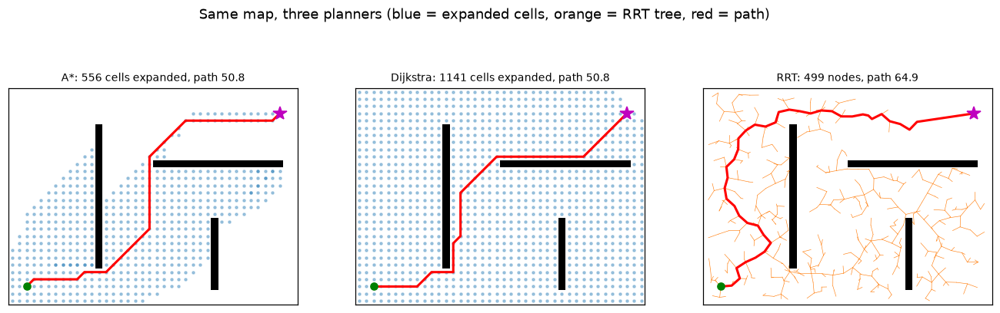
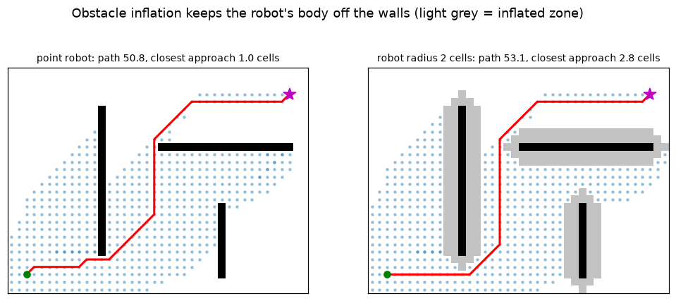

# Mobile Robot Navigation (A*, Dijkstra, RRT, obstacle inflation)


A small 2D simulation of a differential-drive robot. It plans a collision-free
path on an occupancy grid, keeps a safety margin around obstacles, compares
three planners, and follows the path with a pure-pursuit controller.



## Run

```
python -m venv .venv
.venv\Scripts\activate
pip install -r requirements.txt
python -m unittest discover -s tests -t .
python demo.py            # plan with A*, follow with pure pursuit -> docs/demo.png
python planners_demo.py   # compare planners and show inflation    -> docs/planners.png, docs/inflation.png
python benchmark.py       # random-grid benchmark (about 10 s)     -> docs/benchmark.md
```

## How it works

- `robotnav/planner.py`: A* and Dijkstra on an 8-connected grid, with no corner
  cutting through diagonal obstacles. Dijkstra is A* with no heuristic. Both
  return a `PlanResult` (path, cost, cells expanded) so planners can be compared.
- `robotnav/rrt.py`: RRT, a sampling-based planner that grows a random tree in
  continuous space, with collision checking along each segment.
- `robotnav/inflation.py`: grows obstacles by the robot's radius so a point
  planner keeps the robot's body off the walls, plus a `clearance` measure.
- `robotnav/controller.py`: unicycle kinematics and a pure-pursuit follower
  that steers toward a lookahead point and slows down in sharp turns.
- `tests/`: unit and property tests (61): reachability, optimality, inflation
  geometry, RRT collision freedom, benchmark repeatability, and more.

## Comparing the planners



On this map A* and Dijkstra find the same shortest path (50.8), but Dijkstra
expands 1,141 cells against A*'s 556 because it searches in every direction.
RRT reaches the goal with a longer, wigglier path (64.9) found by random sampling.

### Benchmark on random grids

40x40 grids, start and goal at opposite corners, 30 solvable grids per density
(unsolvable ones are skipped). RRT: step 1.5 cells, 10% goal bias, at most 2000
iterations. Full table in [docs/benchmark.md](docs/benchmark.md).

| Obstacle density | RRT success | RRT path vs optimal | A* expanded | Dijkstra expanded | RRT nodes |
|---|---|---|---|---|---|
| 10% | 90% | 1.14x | 301 | 1440 | 419 |
| 20% | 67% | 1.14x | 434 | 1278 | 676 |
| 30% | 37% | 1.08x | 519 | 1083 | 589 |

- **A* and Dijkstra always return paths of the same length** (verified in the
  tests on 40 random grids), but A* expands 2 to 5 times fewer cells.
- **RRT fails more often as the map fills up**: success falls from 90% to 37%,
  even though a path always exists. It is also not optimal.
- Do not read the "1.08x" at 30% as RRT getting better: only the easiest
  problems succeeded there, so that average covers a biased subset.
- RRT's run time is higher here (see the full table) because this version
  scans every tree node to find the nearest one. That says nothing about RRT in
  general; a spatial index would change it.

## Obstacle inflation



A grid planner treats the robot as a point, so its path can graze a wall corner.
Inflating obstacles by the robot's radius (2 cells here) moves the closest
approach from 1.0 to 2.8 cells, at the cost of a slightly longer path (53.1
against 50.8). Inflation can also close narrow gaps entirely, which a test checks.

## Limitations

- The grid is static and fully known; there is no sensing or replanning.
- Distances are in cell units; the benchmark timings are pure Python on one
  machine and only meaningful relative to each other.
- Random Bernoulli obstacle maps are not realistic environments. At 30% density
  most grids have no path at all, so the solvable ones are unusual.
- RRT is the basic version: no rewiring (RRT*) and no path smoothing.
- Inflation uses a circular robot; a real robot's footprint may not be round.

## Roadmap (my next steps)

- [ ] Add RRT* (path rewiring) and measure how close it gets to optimal
- [ ] Use a spatial index for RRT's nearest-node search and re-time it
- [ ] Add a PID speed loop and measure cross-track error vs lookahead
- [ ] Port the planner and controller to ROS 2 nodes and run in Gazebo
- [x] Inflate obstacles by the robot radius so paths keep a safety margin
- [x] Compare A* with Dijkstra and RRT: path length and cells expanded
